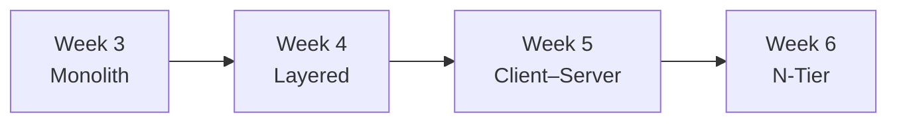

# ENGSE207 Software Architecture — Labs, Midterm & Exam

**Course work for ENGSE207 Software Architecture: the same task-board application rebuilt week by week to practise one architecture style after another, plus the midterm exam and a refactoring project.**


Software Engineering, Rajamangala University of Technology Lanna (RMUTL), Chiang Mai. Student: **Tawan Tiphkun** (67543210033-6).

## Architecture progression



| Folder | Architecture | What changes |
|---|---|---|
| [`week3-starter-code`](week3-starter-code) | Monolith | All routes, logic and SQL in one `server.js`, the baseline to refactor |
| [`week4-layered`](week4-layered) | Layered | Split into controllers → services → repositories; includes an analysis and reflection report |
| [`week5-client-server`](week5-client-server) | Client–Server | Frontend and API run separately (API on a VM with PM2); deployment guide and architecture comparison |
| [`week6-ntier`](week6-ntier) | N-Tier | Nginx web tier, Node.js app tier and PostgreSQL data tier on separate layers, with a VM-vs-Docker analysis |

Later weeks live in their own repositories: [N-tier with Docker](https://github.com/tawan230666/engse207-task-board) · [load balancing + Redis](https://github.com/tawan230666/Week6_lab_ntier_redis_loadbalance) · [event-driven with RabbitMQ](https://github.com/tawan230666/week7_lab_event_driven_rabbitmq) · [secured JWT microservices](https://github.com/tawan230666/engse207-termproject-jwt-microservices) · Final labs [Set 1](https://github.com/tawan230666/final-lab-set1) and [Set 2](https://github.com/tawan230666/engse207-final-lab2-67543210033-6-67543210049-2).

## Midterm & exam

| Folder | Description |
|---|---|
| [`ENGSE207-Midterm-Submission/midterm-individual-…`](ENGSE207-Midterm-Submission/midterm-individual-67543210033-6) | Library management system refactored from a monolith into a 3-layer architecture (presentation / business / data) with validation in the business layer |
| [`ENGSE207-Midterm-Submission/midterm-bonus-…`](ENGSE207-Midterm-Submission/midterm-bonus-67543210033-6) | Bonus: the same system split into an independent **frontend** and **REST backend**, with a written [before/after architecture comparison](ENGSE207-Midterm-Submission/midterm-bonus-67543210033-6/ARCHITECTURE_COMPARISON.md) |
| [`exam/product-layered`](exam/product-layered) | Midterm exam: a product-management app built in a layered architecture |

## Run any project

Each folder is a standalone Node.js app. Its SQLite database is created automatically on first start (week 6 uses PostgreSQL; see its `database/init.sql`).

```bash
git clone https://github.com/tawan230666/ENGSE207.git
cd ENGSE207/week4-layered        # or any other folder
npm install
npm start                        # http://localhost:3000
```

For the midterm bonus, start `backend/` with `npm start`, then open `frontend/index.html`.
